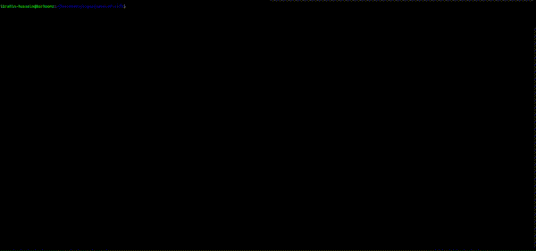

# Game-of-Life

shout out to the project creator -> https://robertheaton.com/2018/07/20/project-2-game-of-life/

Game of Life (or just “Life”) is not really a game. There’s no winning or losing or destroying your opponent mentally and spiritually. Life is a “cellular automaton” - a system of cells that live on a grid, where they live, die and evolve according to the rules that govern their world.

Life’s simple, elegant rules give rise to astonishingly complex emergent behavior. It is played on a 2-D grid. Each square in the grid contains a cell, and each cell starts the game as either “alive” or “dead”. Play proceeds in rounds. During each round, each cell looks at its 8 immediate neighbors and counts up the number of them that are currently alive.

**This is what it will look like**


you can run simply by typing the following:
```bash
python3 life_game.py
```